# Jarvis demo

A clickable, fully simulated copy of **Jarvis**, the site monitor I built to look after small-business websites. It runs on four fictional sites, so you can break them on purpose and watch Jarvis detect the outage, explain it in plain English, propose a guarded one-file fix, email you, and recover once you approve.

Nothing here is real: the sites use `.example` domains, the "model", pull requests, emails and redeploys are scripted, and the page makes no network requests. There are no keys, no login and no back end.

**[Try the demo →](https://jarvis-demo.pages.dev)** · **[The real Jarvis →](https://github.com/cianmccaul/site-monitor)**

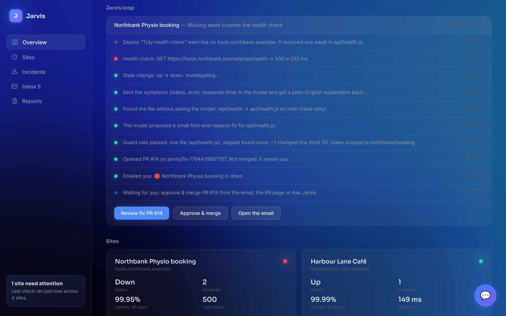

## What Jarvis is

Every 15 minutes Jarvis checks each site. When one goes down, it asks an AI model what the symptoms most likely mean and emails a short explanation. If the fix is small and safe, it opens a pull request I can approve with one tap from my phone. On Mondays it emails a health report per site: a PageSpeed audit, security headers, a smoke test in a real browser, and a screenshot comparison with last week.

The safety rules are enforced in code, not just written into a prompt:

1. It never touches `main`. It only ever opens a pull request.
2. A fix may change **one file only**.
3. A fix must be **under 15 changed lines**.
4. Its token can only reach **the monitored sites' repos**, so it can't modify itself.
5. If anything is ambiguous or fails, it **fails closed**: no PR, just a note in the email.

## Things to try

Use **Break a site** on the Overview. Each scenario plays out the real loop step by step in the **Jarvis loop** panel, and the emails arrive in **Inbox**.

| Scenario | Site | What happens |
|---|---|---|
| **Missing `await`** | Northbank Physio booking | The health check crashes with a 500. Jarvis maps `/api/health` to `api/health.js` without asking the model, proposes a one-line fix, passes the guard rails and opens a PR. Approve & merge it from the email, the PR page or Ask Jarvis, then watch the redeploy and recovery. |
| **Health file deleted** | Harbour Lane Café | A clean-up commit deletes `api/health.js`, so the check gets a 404. The usual paths don't exist, so Jarvis asks the model for the most likely file (`vercel.json`) and proposes one rewrite line pointing `/api/health` at the identical `api/status.js`. It doesn't recreate the file, because it only edits files that exist. |
| **Slow response** | Brushline Painting | Response times climb (1.9 s, 4.6 s, 8.7 s) and are logged, but don't trigger an alert. When a check passes the 10-second timeout, you get an alert with no PR: the URL is the homepage and the model can't name a file, so Jarvis fails closed. It recovers by itself. |
| **Fix needs two files** | Jarvis Sandbox | An environment variable is renamed and the fix would touch `api/health.js` and `lib/db.js`. Rule 2 rejects it: "flagged for manual review, no PR opened". Use **Fix it by hand** to recover it. |

Also try:

- **Ask Jarvis** (the 💬 button, or "Discuss this incident in Jarvis" in any email). Each incident has three suggested questions such as *Why a 500 and not a 404?*, *Is it safe to merge?* and *What should I check first?*
- **Reports**: the weekly report for each site, with the client-friendly summary and the technical one. **Run weekly report now** emails a fresh set.
- **Sites**: response-time history, 30-day uptime and recent checks for each site.
- **Reset** in the demo bar starts over with a fresh, believable month of history.

## What's real vs simulated

| | In this demo | In the real Jarvis |
|---|---|---|
| Dashboard design (layout, gradient background, cards, fonts, Ask Jarvis panel) | **Real.** `css/jarvis.css` is the production stylesheet, unchanged. The shader and the chat panel's styles are copied as-is too. | Same |
| Alert, recovery and weekly-report emails | **Real layout**, rendered in an in-demo inbox | Sent through Resend |
| Order of the loop: check → explain → find file → fix → guard rails → PR → email | **Real**, step for step from `check.js` and `proposeFix.js` | Same |
| Route-to-file lookup, find-and-replace fix, changed-line count, 15-line limit | **Real code**, ported from `proposeFix.js` and run against fictional repo files | Same, against the sites' GitHub repos |
| "Approve & merge" asks you to confirm and never merges when a link is opened | **Real behaviour**, mirrored from `api/approve.js` | Signed 7-day link, then a GitHub merge |
| Health checks | Simulated, every 20 seconds | Real HTTP requests every 15 minutes (GitHub Actions) |
| Outage explanations and the model's file and fix suggestions | Scripted, written in the real explanations' style | Live model through Groq |
| Ask Jarvis replies | Scripted per incident, plus a keyword match for typed questions | Live model with the incident's details |
| Pull requests, merges, redeploys | Simulated, with in-demo PR pages | GitHub and Vercel |
| Weekly audits (PageSpeed, headers, smoke test, screenshot diff) | Fictional results | Google PageSpeed API, Playwright, pixelmatch |
| Sites, repos, incidents, people | All fictional (`.example` domains) | My clients' sites |
| Login, API keys, database | None | Cookie sign-in, repo secrets, JSON state committed to the repo |

**No network calls.** The page's Content-Security-Policy (`public/_headers`) sets `connect-src 'none'`, so the browser itself would block any request to Groq, Resend, GitHub, Vercel or anywhere else. The only third-party requests are the Google Fonts the real dashboard also loads.

## More screenshots

| | |
|---|---|
| 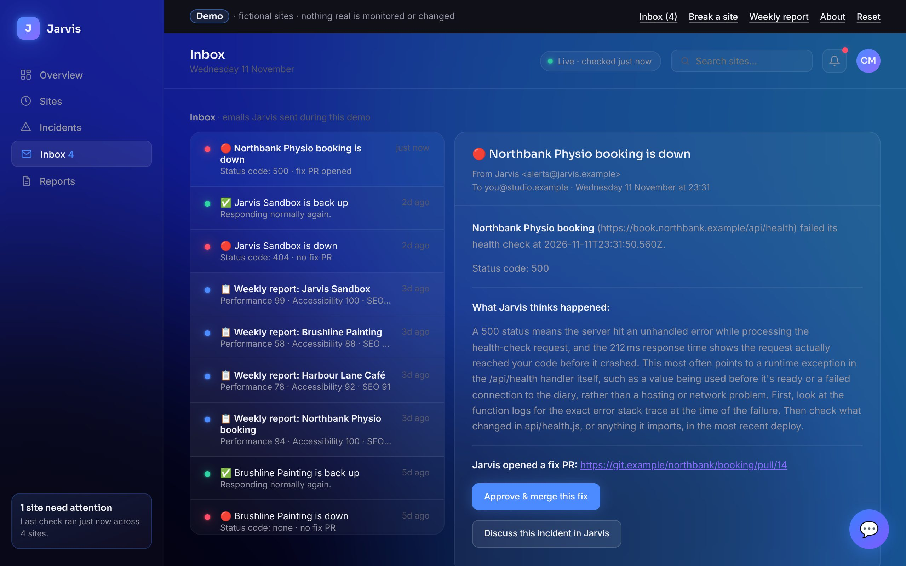 | 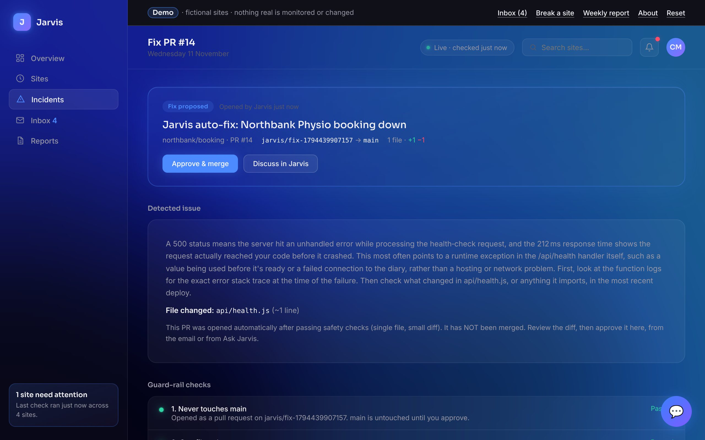 |
| The alert email, in the same layout as the real one | A fix PR: the diagnosis and the five guard-rail checks |
| 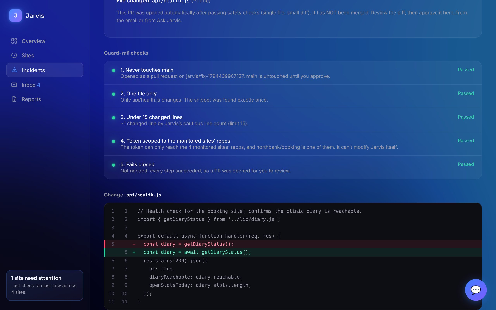 | 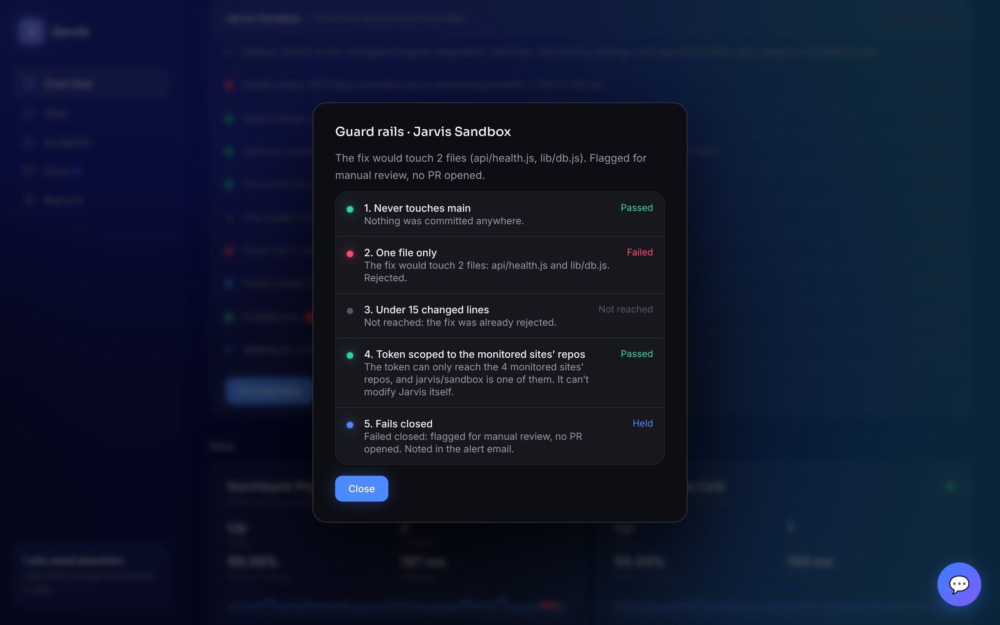 |
| One file, one line | A two-file fix rejected: failed closed |
| 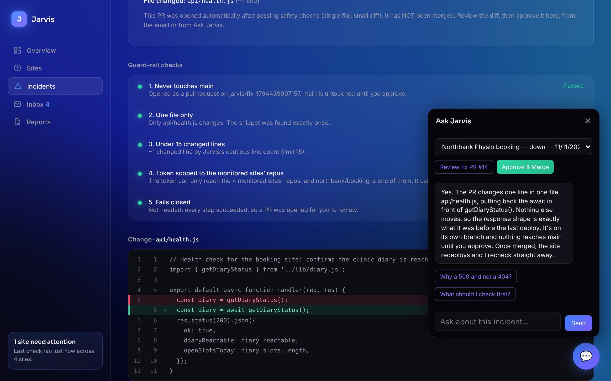 | 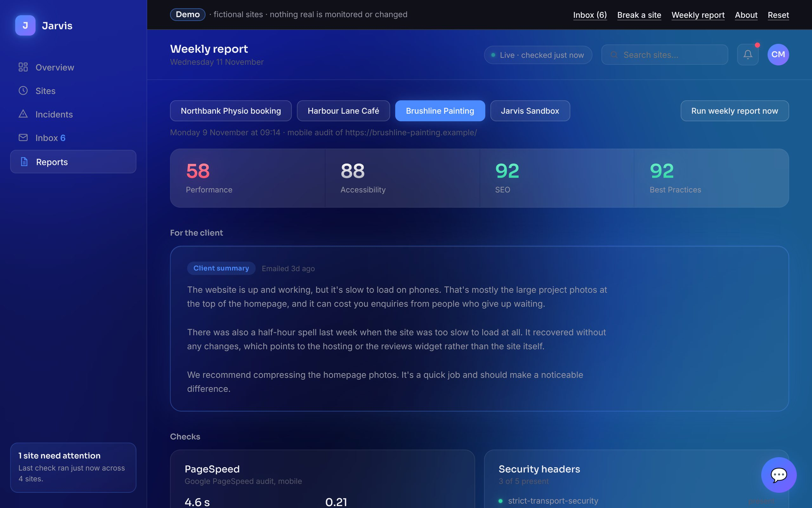 |
| Ask Jarvis with suggested questions | Weekly report |
| 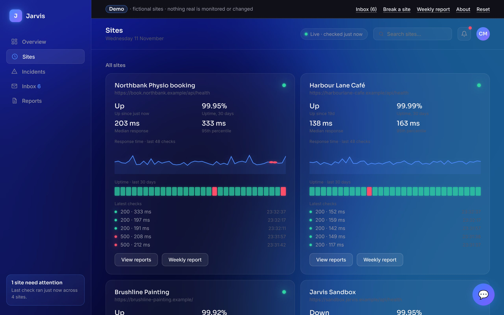 | 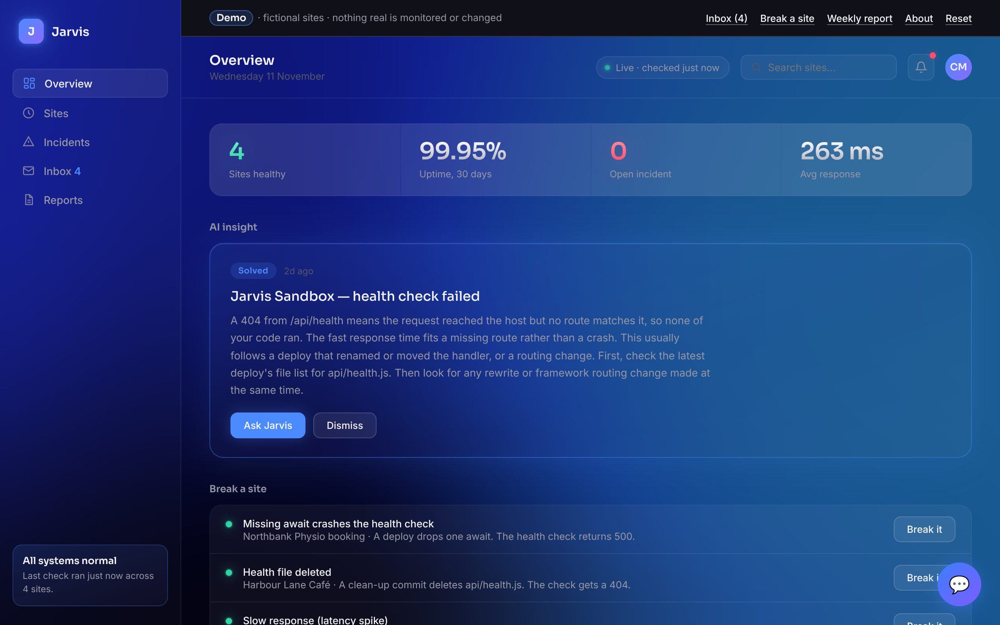 |
| Uptime and response-time history | All systems normal |

On a phone (360 px):

<p>
  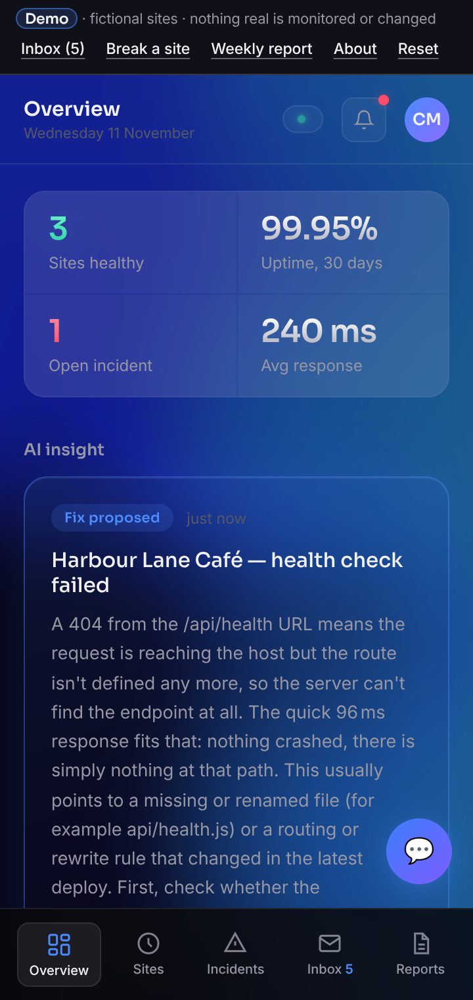
  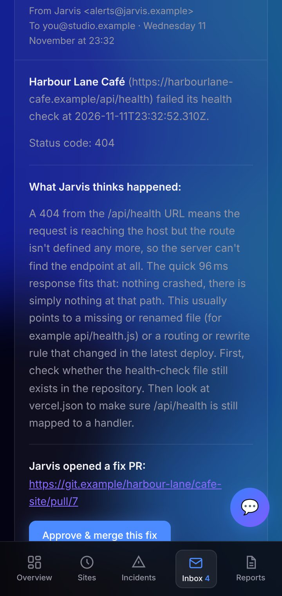
  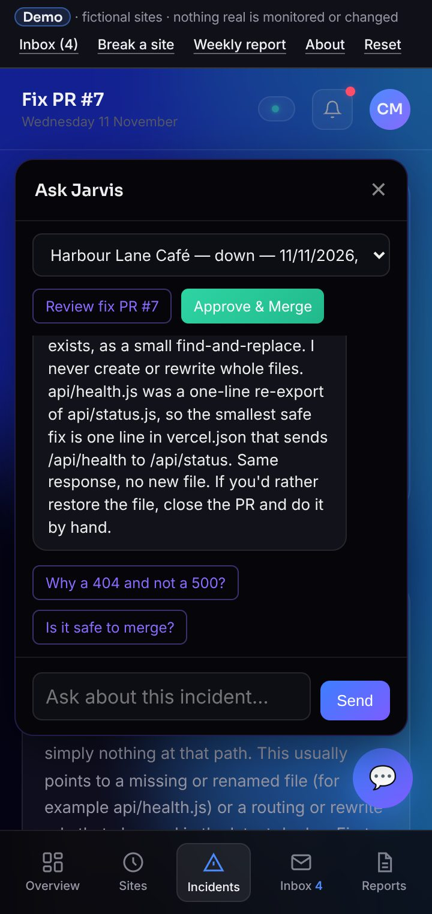
</p>

## How it's built

A static site in `public/`, with no build step, framework or dependencies. It totals about 145 KB of code, plus 60 KB of icons.

```
public/
  index.html        the production dashboard markup, plus the demo bar, Inbox and Reports
  css/jarvis.css    the production stylesheet, unchanged
  css/demo.css      the new screens, built only from the production tokens and components
  js/shader.js      the production WebGL background, unchanged
  js/data.js        the fictional world: sites, repo files, scenarios, scripted answers, reports
  js/app.js         the pretend back end (checks, the loop, guard rails, PRs, emails) and the screens
  js/chat.js        the production Ask Jarvis panel, answering from scripts instead of /api/chat
  _headers          security headers and the CSP for Cloudflare Pages
docs/screenshots/   the images above
```

State lives in `localStorage`, so a visitor can reload mid-scenario and carry on. Reset wipes it. Every screen has its own URL (`#/inbox`, `#/pr/northbank/14`, `#/reports/painting`), so you can send a client straight to one.

## Run it locally

Any static file server works:

```bash
cd public && python3 -m http.server 8080
```

Then open http://localhost:8080.

## Deploy to Cloudflare Pages

The free plan is fine, and it can be used for client work. There's no build step: Cloudflare just serves the `public/` folder.

**From the dashboard (deploys on every push):**

1. In the Cloudflare dashboard, go to **Workers & Pages** → **Create**. Choose the **Pages** tab, then **Import an existing Git repository**. The create screen may default to Workers, so make sure you're on the Pages tab.
2. Connect GitHub if asked, then pick `cianmccaul/jarvis-demo`.
3. Build settings:
   - **Production branch:** `main`
   - **Framework preset:** None
   - **Build command:** leave empty
   - **Build output directory:** `public`
4. Click **Save and Deploy**. The site goes live at `https://<project-name>.pages.dev`. If `jarvis-demo.pages.dev` was free, that's the link at the top of this README; otherwise update it.
5. Optional: under the project's **Custom domains**, add something like `jarvis.yourdomain.com`. Cloudflare sets up DNS and HTTPS for you if the domain is on Cloudflare; otherwise it shows you the CNAME record to add.

Every other branch gets its own preview URL, which is handy for checking changes before they reach the link you've shared.

**From the command line instead:**

```bash
npx wrangler login
```

```bash
npx wrangler pages deploy public --project-name jarvis-demo
```

`_headers` is picked up automatically either way. To check it after deploying, run `curl -sI https://jarvis-demo.pages.dev | grep -i content-security` and you should see `connect-src 'none'`.

---

Built by [Cian McCaul](https://github.com/cianmccaul). See also the [Northbank Physio clinic platform demo](https://github.com/cianmccaul/clinic-platform-demo), whose fictional clinic owns the booking site Jarvis watches here.
